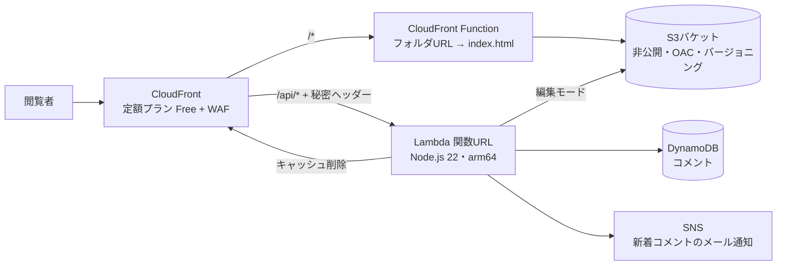

# コメント承認とブラウザ編集に対応したサーバーレスのガイドサイト

AWS上で実際に運用している小さなWebサイトです。**月額ほぼ0円**で動いています。
内容は、マレーシアの INTI International College Subang に留学する日本人向けの生活ガイドのシリーズで、記事ごとのコメント欄、コメントの承認フロー、管理者がブラウザ上でページを直接書き換えられる「編集モード」を備えています。

**公開中のサイト:** https://dflhc8c49py96.cloudfront.net/

構成はすべて1つの AWS SAM テンプレートで定義し、いくつかのシェルスクリプトでデプロイします。サーバー、コンテナ、フレームワーク、フロントエンドのビルド工程はありません。

## 構成



| パス | 処理 |
|---|---|
| `/`、`/shopee/`、`/<slug>/` | 非公開のS3バケットから静的ページを配信。CloudFront Function がフォルダのURLを `index.html` に読み替え、`/shopee` は `/shopee/` に転送する。 |
| `GET/POST /api/comments` | 公開のコメントAPI。新しいコメントは「承認待ち」で保存し、管理者にメールで通知する。表示されるのは承認済みのコメントだけ。 |
| `/api/admin/*` | 管理者専用API(ヘッダーの合言葉で認証)。全記事のコメントの承認・削除、ページ一覧、編集モードでのページの読み書き。 |

## 機能

- **記事のシリーズ化**:`./new-page.sh bank "銀行口座 編" "…"` でひな形から記事を作成し、目次にも自動で追加する。
- **記事ごとのコメントと承認制**:DynamoDBに記事単位で保存する。S3に実在する記事にしかコメントできないので、存在しないページ名を使ったスパムでテーブルが埋まることはない。
- **管理画面**:全ページの一覧(各ページの編集リンクつき)と、全コメントの承認・削除。記事ごとに絞り込める。
- **編集モード**:ページのURLに `#edit` を付けて開くと、本文が `contenteditable` になる。保存時は、スクリプトで表示が変わった画面ではなく、S3にある元のファイルを基にページを組み立て直してS3に書き込み、CloudFrontのキャッシュを削除する。
- **安全な保存**:S3オブジェクトのETagを使った楽観ロックで、2台の端末からの同時編集による上書きを防ぐ。S3のバージョニングで、過去の版を90日間保持する。
- **ブラウザとGitの食い違いを防止**:`deploy.sh` は公開したページのETagを記録する。その後に編集モードでページが変更されていれば上書きせずに止まり、`pull-site.sh` での取り込みを促す。取り込んだ変更は通常のGitの差分として確認できる。
- **デプロイ先の確認**:AWS CLIが `.expected-account` と違うアカウントにログインしていると、`deploy.sh` は止まる。

## 設計の判断

| 判断 | 理由 |
|---|---|
| API Gateway ではなく **Lambda関数URL** | API Gatewayの無料枠(12か月)が終わったあとのリクエスト課金がない。TLS、キャッシュの振り分け、WAFは手前のCloudFrontが担う。 |
| 関数URLを **秘密のオリジンヘッダー** で保護 | CloudFrontからPOSTの本文つきで呼び出せるよう、関数URLはIAM認証なしにしている。CloudFrontを経由しないリクエスト(`x-origin-verify` ヘッダーなし)には403を返す。 |
| **OAC** つきの完全非公開S3 | ページはCloudFront経由でしか読めない。 |
| DynamoDBは **プロビジョンド**(2 RCU / 2 WCU) | 期限なしの無料枠が適用されるのはプロビジョンドだけ。 |
| CloudFrontの **定額プラン(Free)** | 月0ドルで超過料金がない。アクセス急増や攻撃があっても想定外の請求にならない。 |
| キャッシュポリシーは **マネージドのみ** | Freeプランではカスタムのキャッシュポリシーを使えない。 |
| **素のHTML/CSS/JS**、スタイルはページ内に記述 | 人、編集モード、AIアシスタントのどれでも、ビルドなしでそのまま直せる。 |
| コメントは `textContent` でだけ表示 | 利用者が入力したHTMLがページに入り込むことはない。 |
| 合言葉の比較は時間一定 | 管理用の合言葉とオリジンの秘密は、SHA-256 と `timingSafeEqual` で比較する。 |
| おとり入力欄、Cloudflare Turnstile(任意)、人による承認 | スパム対策を重ねる。承認するまで何も公開されない。 |
| テンプレートに AWS Budgets のアラート | 月の請求が設定額を超えたらメールで通知する。 |

## 費用

| 項目 | 月額 |
|---|---|
| CloudFront 定額プラン Free(100万リクエスト、100 GB、WAF、S3 5 GB分のクレジットを含む) | 0ドル |
| Lambda、DynamoDB(プロビジョンド)、SNSのメール通知 | 0ドル(期限なしの無料枠) |
| AWS Budgets(2つまで無料) | 0ドル |

## デプロイでぶつかった問題と解決方法

いずれも本番公開の初日に実際に起きた問題です。

1. **すべてのリージョン・サービスで `OptInRequired: The AWS Access Key Id needs a subscription for the service`**
   CLIが、使っていない別のAWSアカウントにログインしていた。そのアカウントは無料プランのままで利用が制限されていた。正しいアカウントにログインし直して解決。再発防止として、`deploy.sh` に `.expected-account` による確認を追加した。
2. **`sam deploy --guided` で、NoEchoパラメーターに空欄を入れられない**
   「Turnstileを使わない」を空の値で表せなかった。Lambda側で `none` を無効の意味として扱うようにした。
3. **CloudFrontをFreeプランにしたあと、CloudFormationの更新が拒否された**
   エラーは「定額プランのディストリビューションからはWeb ACLを外したり置き換えたりできない」。プランがテンプレートの外でWAFを付けたため、次のスタック更新がそれを外そうとしていた。スタックは自動で元に戻った。`WebAclArn` パラメーターを `WebACLId` に渡すようにし、今付いているWAFのARNをディストリビューションから読んで `samconfig.toml` に書き込む `set-webacl.sh` を用意して解決。
4. **`aws s3 sync --delete` で公開中のトップページが消えた**
   作業フォルダを入れ替えた際に `site/index.html` がなくなっていた。S3のバージョニングで過去の版がすべて残っていたため、失われたものはなかった。
5. **編集モードでチェックリストの文字にカーソルを置けない**
   その文字が `<label for=…>` で、クリックするとフォーカスがチェックボックスに移ってしまう(`contenteditable` の中でも同じ)。編集中だけ `for` を外し、保存するHTMLを組み立てるときに戻すようにした。
6. **フォルダのURLが AccessDenied になる**
   S3 RESTオリジンとOACの組み合わせでは、CloudFrontのデフォルトルートオブジェクトは `/` にしか効かない。`index.html` を補う小さな CloudFront Function(Freeプランでも利用可)を追加した。

## ファイル構成

```
site/                  公開するファイル(index.html = 目次、<slug>/index.html = 各記事)
  comments.js          全記事共通のコメント欄
  edit.js              編集モード
  admin.html           管理画面
templates/             新しい記事と目次のひな形
src/app.mjs            Lambda:コメント、ページ一覧、編集モードの保存
template.yaml          AWS SAM テンプレート
deploy.sh              デプロイ(アカウント確認と、編集モードとの食い違いチェックつき)
pull-site.sh           編集モードで変わったページをGitに取り込む
new-page.sh            新しい記事を作る
set-webacl.sh          スタック更新時にFreeプランのWAFを維持する
CLAUDE.md              Claude Code 向けの作業ルール(文体、デプロイ時の安全確認)
docs/DEPLOY.ja.md      デプロイと運用の詳しい手順
```

## 自分の環境にデプロイする

AWS CLI、AWS SAM CLI、Node.js 22 が必要です。

```bash
openssl rand -hex 24          # AdminToken
openssl rand -hex 24          # OriginSecret
sam build && sam deploy --guided   # TurnstileSecret は none(使わない場合)
./deploy.sh --site-only
```

そのあと、コンソールでCloudFrontのディストリビューションを定額プランのFreeに切り替え、`./set-webacl.sh` を実行します。詳しい手順は [docs/DEPLOY.ja.md](docs/DEPLOY.ja.md) にあります。

## 作り方について

最初のページの下書きから、SAMテンプレート、編集モード、デプロイ用スクリプトまで、Claude(Anthropic)をAIペアプログラマーとして使って作りました。サイトの内容は個人による非公式のガイドで、INTIやShopeeとは関係ありません。
